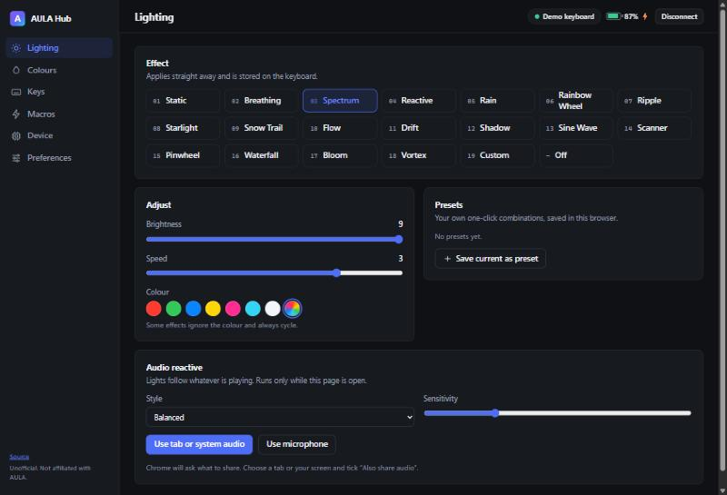
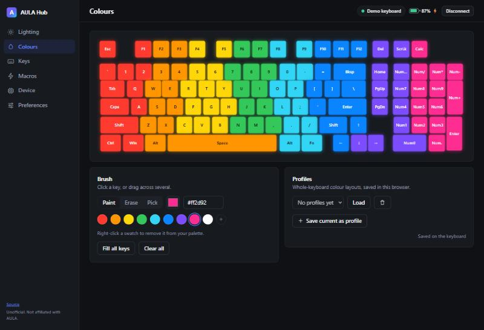
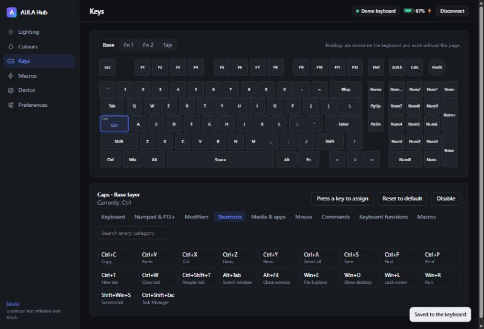

# AULA Hub (web)

Control an **AULA F99 Pro** keyboard from the browser. Lighting, per-key colours, key remapping, macros and battery level, with no driver or app to install. The page talks to the keyboard directly over [WebHID](https://developer.mozilla.org/docs/Web/API/WebHID_API); nothing is sent to a server.

This is a web port of [xx12ek/aula-f99-pro-hub](https://github.com/xx12ek/aula-f99-pro-hub), a Windows desktop app. The reverse-engineered protocol is theirs; this project rewrites the device layer in JavaScript and replaces the interface.

| Lighting | Per-key colours | Keys |
|---|---|---|
|  |  |  |

## What it does

- **Lighting**: 20 effects, brightness, speed and colour, plus your own one-click presets.
- **Per-key colours**: paint the keys, keep a palette, save whole layouts as profiles.
- **Keys**: remap any key on four layers (Base, Fn 1, Fn 2, Tap) to a key, shortcut, media key, mouse button, built-in keyboard function or macro. Press-to-assign is supported.
- **Macros**: record or edit key sequences stored in the keyboard's own 10 KB macro memory.
- **Knob**: change what the knob does, and recover from the keyboard's own "knob mode".
- **Audio reactive**: lights follow tab, system or microphone audio while the page is open.
- **Device**: battery level, sleep timer, backup to a file, restore points, factory reset.
- **Preferences**: theme, accent colour, density, sidebar style, keyboard size, start page and behaviour toggles.

Remaps, macros and lighting are stored on the keyboard, so they keep working after the page is closed.

## Requirements

- A Chromium browser on a computer: Chrome, Edge or Opera. Firefox and Safari do not have WebHID.
- The page must be served over `https://` (or `http://localhost`).
- AULA F99 Pro: wired `258A:010C`, or its 2.4G receiver `3554:FA09`.

| Connection | What works |
|---|---|
| USB cable | Everything |
| 2.4G receiver | Battery, lighting, sleep timer; viewing colours and the base key layer |
| Bluetooth | Not supported |

The wireless limit is in the keyboard's firmware: over 2.4G it does not accept key, colour or macro writes. While the cable is plugged in, the keyboard ignores the receiver.

On Linux, Chrome needs permission to open the device. Add a udev rule and re-plug the keyboard:

```
# /etc/udev/rules.d/50-aula-f99.rules
KERNEL=="hidraw*", ATTRS{idVendor}=="258a", ATTRS{idProduct}=="010c", MODE="0660", TAG+="uaccess"
KERNEL=="hidraw*", ATTRS{idVendor}=="3554", ATTRS{idProduct}=="fa09", MODE="0660", TAG+="uaccess"
```

## Run it locally

No build step and no dependencies. Any static file server works; one is included:

```bash
node tools/serve.mjs
```

Then open <http://localhost:5173>. Add `?demo` to the address (or press **Try the demo**) to use a simulated keyboard.

```bash
npm test
```

runs the protocol tests against the same simulated keyboard.

## Put it on a website

The app is plain HTML, CSS and ES modules with relative paths, so it can live in any folder of a site.

```bash
node tools/build.mjs
```

copies `index.html`, `css/`, `js/` and `assets/` into `dist/`. Upload that folder. Things to check on the host:

- The site is served over HTTPS.
- `.js` files are served as `text/javascript`.
- If the app is embedded in an `<iframe>`, the frame needs `allow="hid"` (and `allow="hid; display-capture; microphone"` for audio-reactive lighting).
- The site does not send a `Permissions-Policy` header that disables `hid`.

## How it is organised

```
index.html            page shell
css/app.css           all styling; themes are CSS variables
js/main.js            connection, navigation, background checks
js/prefs.js           preferences and restore points (localStorage)
js/music.js           audio-reactive lighting
js/hid/protocol.js    constants, record decoding, byte helpers
js/hid/transport.js   WebHID links: wired (feature reports) and 2.4G
js/hid/device.js      keyboard session: verified writes, snapshots
js/hid/macro.js       macro memory encoding
js/hid/demo.js        simulated keyboard used by the demo and tests
js/data/              key geometry and the binding catalogue
js/ui/                one file per page, plus shared components
docs/PROTOCOL.md      the protocol, in English
```

Every write is read back and compared. If the keyboard did not take it, the previous value is restored and an error is shown.

## Differences from the desktop app

A web page cannot hook the system keyboard, change system volume or brightness, draw overlays or run in the background, so these parts of the desktop app are not here:

- Knob actions carried out by the app (screen brightness, switching effects, custom knob slots) and its on-screen display. The knob bindings the keyboard performs itself still work.
- Tray icon and start at login.
- Background recovery from knob mode. Here it only runs while the page is open and in front (configurable).
- System audio capture without a prompt. Here Chrome asks you to share a tab, screen or microphone.

## Status

The device layer follows the desktop app's tested protocol code and is covered by tests against a simulated keyboard. The web port has been confirmed working with a physical F99 Pro in Microsoft Edge. A restore point is saved automatically when you connect by cable, so changes can be undone. See [docs/PROTOCOL.md](docs/PROTOCOL.md) for which protocol facts are confirmed on hardware.

## Credits and licence

MIT. Protocol research and the original application: [xx12ek/aula-f99-pro-hub](https://github.com/xx12ek/aula-f99-pro-hub) and the projects it credits ([AulaSofwareLinux](https://github.com/yhuikzdtguioaert/AulaSofwareLinux), [aula-f99-controller](https://github.com/pradyumnac/aula-f99-controller), [aula-f75-linux-drivers](https://github.com/cloudglides/aula-f75-linux-drivers), [OpenRGB](https://github.com/CalcProgrammer1/OpenRGB)).

This is an unofficial project and is not affiliated with AULA. It never touches the keyboard's firmware.
